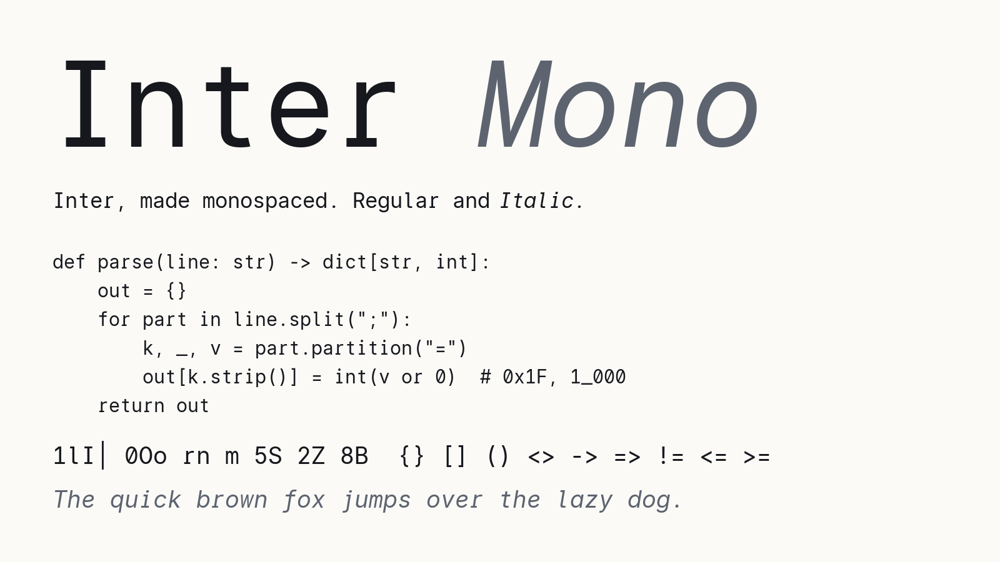

# Inter Mono

A monospaced adaptation of [Inter](https://rsms.me/inter/), for code and terminals.
Free and open source under the SIL Open Font License.



**This is an unofficial derivative.** It is not made, reviewed or endorsed by the
Inter project. Please don't report its problems to Inter.

## What it is

- Every character sits in one 1229-unit cell (0.6 em), spaces included.
- Two styles: Regular and Italic.
- About 3,000 characters: Latin, Greek, Cyrillic, arrows, maths and box drawing.
- Wide letters (m, w, M, W) are narrowed with their stroke weight kept.
- Narrow letters (i, j, l, r, f, t) get slabs so they fill the cell.
- `1 l I |` and `0 O` are all distinct: flag one, tailed l, serifed I, slashed zero.
- No kerning and no ligatures, so columns always line up.

## Install

Download the zip from the Releases page, or take the files in [`fonts/ttf`](fonts/ttf).

- **macOS:** open each `.ttf` and choose Install Font.
- **Windows:** right-click each `.ttf` and choose Install.
- **Linux:** copy the `.ttf` files to `~/.local/share/fonts` and run `fc-cache`.

Then pick "Inter Mono" in your editor or terminal.

### Web

```css
@font-face {
  font-family: "Inter Mono";
  font-style: normal;
  font-weight: 400;
  src: url("InterMono-Regular.woff2") format("woff2");
}
@font-face {
  font-family: "Inter Mono";
  font-style: italic;
  font-weight: 400;
  src: url("InterMono-Italic.woff2") format("woff2");
}
code, pre { font-family: "Inter Mono", monospace; }
```

The `.woff2` files are in [`fonts/webfonts`](fonts/webfonts).

## Folders

| Folder | Contents |
|---|---|
| `fonts/ttf` | Hinted fonts, for installing |
| `fonts/ttf-unhinted` | The same without hinting |
| `fonts/webfonts` | `.woff2` for websites |
| `docs` | Specimen page (works with GitHub Pages) |
| `sources` | Build scripts and the Inter fonts they start from |

## Building

Inter Mono is generated by a script from the Inter 18pt static fonts
(version 4.001). Nothing is drawn by hand.

```sh
pip install fonttools skia-pathops ttfautohint-py brotli pillow
sh sources/build.sh
```

## Known limits

- Regular and Italic only; no Bold.
- A few very wide characters are cramped in one cell (for example Ѹ and ₯).
- Tested on macOS. Hinting on Windows has not been checked by eye.

## Credits

- **Inter** is designed by Rasmus Andersson and The Inter Project Authors.
  All the letter shapes come from Inter. "Inter" is a trademark of Rasmus Andersson.
- **The monospaced adaptation** was designed and built by Claude, an AI model
  made by Anthropic.

## Licence

[SIL Open Font License 1.1](OFL.txt). You may use, change and share the fonts
freely, including commercially. You may not sell the fonts by themselves, and
changed versions must stay under the same licence.
